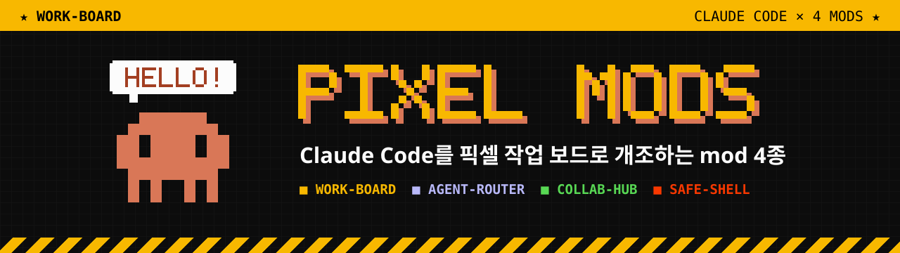
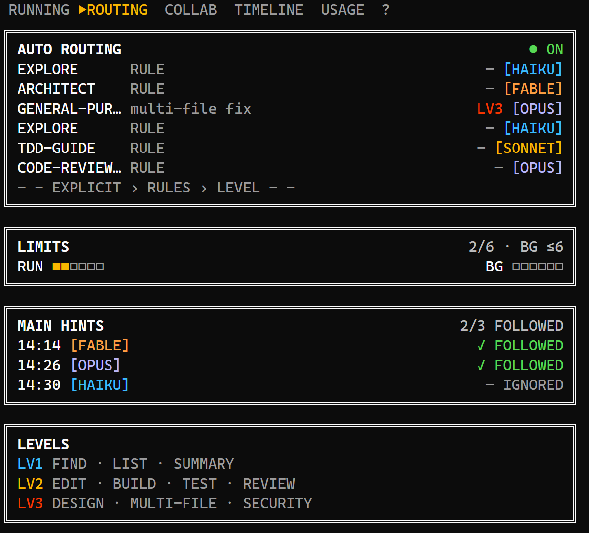
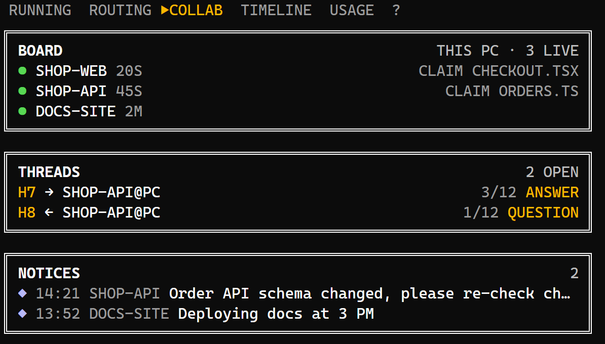

<p align="center">
  
</p>

<div align="center">


**mod 4개** | 작업 보드 · 모델 배정 · 세션 협업 · 명령 검사 | Windows · macOS | Claude Code

</div>

---

<div align="center">

<a href="#설치하기"></a>
<a href="#업데이트"></a>
<a href="#화면-보기"></a>
<a href="#mod-하나씩-보기"></a>
<a href="#명령어-목록"></a>
<a href="#지우기"></a>

</div>

---

<br>

<p align="center"><b>Claude가 지금 무엇을 하는지, 터미널 옆 픽셀 보드에서 한눈에 봅니다.</b></p>

<p align="center">Claude Code용 mod 네 개를 모아 둔 저장소입니다.<br>
픽셀 아트 스타일의 작업 보드(<b>work-board</b>)와, 보드가 읽어 가는 세 가지 보조 mod(<b>agent-router</b>, <b>collab-hub</b>, <b>safe-shell</b>)로 이루어져 있습니다.<br>
각 mod는 독립된 플러그인 폴더이며, work-board는 나머지 세 mod를 의존성으로 선언합니다.</p>

<table>
<tr>
<td width="52%" valign="top">

</td>
<td valign="top">

### 보드에서 보이는 것

- **맨 위 노란 띠**: 프로젝트 폴더와 세션 시간
- **픽셀 Claude와 말풍선**: 지금 하는 일을 한 단어로 (THINKING, CODING, RUNNING, TESTING, DONE …)
- **왼쪽 글자**: 모델, 플랜, 주간·5시간 남은 사용량
- **STATUS**: RAM, CONTEXT 게이지와 함께 일하는 subagent 수, 연결된 세션 수, 막힌 명령 수
- **RUNNING 탭**: 일하는 subagent(PARTY), 쓴 스킬과 플러그인, 다른 세션, 요청과 단계별 timeline, 건드린 파일

설치하면 세션을 열 때마다 화면 오른쪽에 자동으로 열립니다.

> 그림은 예시 데이터를 넣어 실제 보드 코드로 그린 화면입니다.

</td>
</tr>
</table>

| 처음이세요? | 쓰고 계세요? | 무엇을 할 수 있나요? | 그만 쓰려면? |
|:---:|:---:|:---:|:---:|
| **[설치하기](#설치하기)** | **[업데이트](#업데이트)** | **[명령어 목록](#명령어-목록)** | **[지우기](#지우기)** |
| Claude Code 안에서 명령 다섯 줄 | 마켓플레이스 새로 받기 | 보드 · 라우팅 · 협업 · 셸 | mod 네 개 지우기 |

<br>

---

# 📘 소개

## 한눈에 보기

| | mod | 하는 일 | 보드에서 보는 곳 |
|:---:|---|---|---|
| 🟨 | **work-board** | 화면 오른쪽에 붙는 픽셀 작업 보드. 상태, 사용량, 요청 timeline, 건드린 파일 | 보드 전체 |
| 🟪 | **agent-router** | subagent를 만들 때 일의 종류와 난이도로 모델을 고르고, 동시 실행 수를 막습니다 | ROUTING 탭, PARTY 창 |
| 🟩 | **collab-hub** | 같은 PC의 세션끼리 공지, 파일 claim, 요청과 답을 주고받습니다 | COLLAB 탭, SESSIONS 창 |
| 🟥 | **safe-shell** | Bash와 PowerShell 명령을 실행 전에 3단계로 검사합니다 | STATUS의 BLOCKED 수, 알림(toast) |

같은 네 mod를 **Windows 버전**(저장소 루트, `<mod>@pixel-mods`)과 **macOS 버전**(`macos/` 폴더, `<mod>-macos@pixel-mods`) 두 벌로 둡니다. 명령 이름과 화면은 두 버전이 같습니다. 한 컴퓨터에는 그 OS에 맞는 한 벌만 설치합니다.

## 화면 보기

보드 아래쪽 탭을 누르면 mod마다 자세한 화면이 열립니다.

<table>
<tr>
<th width="33%">ROUTING · agent-router</th>
<th width="33%">COLLAB · collab-hub</th>
<th width="33%">USAGE · work-board</th>
</tr>
<tr>
<td valign="top"></td>
<td valign="top"></td>
<td valign="top"></td>
</tr>
<tr>
<td valign="top">subagent마다 고른 모델과 이유, 동시 실행 한도, 메인 스레드 모델 힌트를 따랐는지</td>
<td valign="top">이 PC에서 돌아가는 세션과 claim한 파일, 주고받는 요청(thread), 공지</td>
<td valign="top">5시간·주간 남은 양과 초기화 시각, 이번 세션에 쓴 양, 최근 7일 기록</td>
</tr>
</table>

TIMELINE 탭은 요청과 단계를 길게 보여 주고, `?` 탭은 명령 안내입니다.

<br>

---

# 🧩 설치와 업데이트

## 설치하기

[Claude Code](https://claude.com/claude-code)가 설치되어 있어야 합니다.

> **설치 명령은 PowerShell이나 터미널에 붙여 넣는 것이 아니라 Claude Code 안에서 입력합니다.**

#### 1단계: Claude Code 켜기

터미널(Windows는 PowerShell, Mac은 Terminal 앱)에서 `claude`를 입력해 Claude Code를 켭니다.

#### 2단계: 명령 입력하기

Claude Code 입력창에 아래 줄을 **한 줄씩** 입력하고 Enter를 누릅니다. 설치 범위(scope)를 물으면 **user**를 고릅니다. 그래야 모든 폴더에서 켜집니다.

**Windows**

```text
/plugin marketplace add akaz01/pixel-mods
/plugin install work-board@pixel-mods
/plugin install agent-router@pixel-mods
/plugin install collab-hub@pixel-mods
/plugin install safe-shell@pixel-mods
```

**Mac**

```text
/plugin marketplace add akaz01/pixel-mods
/plugin install work-board-macos@pixel-mods
/plugin install agent-router-macos@pixel-mods
/plugin install collab-hub-macos@pixel-mods
/plugin install safe-shell-macos@pixel-mods
```

#### 3단계: 다시 켜기

다 입력했으면 Claude Code를 껐다가 다시 켭니다. 오른쪽에 Work Board가 자동으로 열립니다.

> **주의**
> - 한 컴퓨터에는 한 버전만 설치합니다. 두 버전을 같이 켜면 `/board` 같은 명령이 겹쳐서 나중에 켜진 쪽이 거부됩니다.
> - 설치가 됐는지는 입력창에 `/plugin`을 입력해 Installed 목록에서 네 mod가 `@pixel-mods`로 보이는지 확인합니다.
> - 데스크톱 앱의 Code 탭에서는 이 명령을 쓸 수 없습니다. 터미널의 Claude Code에서 user 범위로 설치하면 데스크톱 앱에서도 켜집니다.

### 켜고 끄기

설치한 뒤에는 따로 켤 필요가 없습니다.

- 보드를 `/board close`로 닫으면 다음 세션부터는 자동으로 열리지 않습니다. 다시 `/board`로 열면 그다음 세션부터 다시 자동으로 열립니다.
- mod를 잠시 끄려면 Claude Code 입력창에 `/plugin disable <mod>@pixel-mods`, 다시 켜려면 `/plugin enable <mod>@pixel-mods`를 입력합니다. macOS에서는 mod 이름 뒤에 `-macos`가 붙습니다(예: `work-board-macos@pixel-mods`).

## 업데이트

Claude Code 입력창에 아래 줄을 입력해 마켓플레이스를 새로 받습니다.

```text
/plugin marketplace update pixel-mods
```

그다음 `/plugin`을 입력해 Installed 목록에서 mod를 골라 업데이트하고, Claude Code를 껐다가 다시 켭니다.

## 지우기

Claude Code 입력창에 아래 줄을 한 줄씩 입력합니다.

<details>
<summary><b>Windows</b></summary>

```text
/plugin uninstall work-board@pixel-mods
/plugin uninstall agent-router@pixel-mods
/plugin uninstall collab-hub@pixel-mods
/plugin uninstall safe-shell@pixel-mods
/plugin marketplace remove pixel-mods
```

</details>

<details>
<summary><b>Mac</b></summary>

```text
/plugin uninstall work-board-macos@pixel-mods
/plugin uninstall agent-router-macos@pixel-mods
/plugin uninstall collab-hub-macos@pixel-mods
/plugin uninstall safe-shell-macos@pixel-mods
/plugin marketplace remove pixel-mods
```

</details>

## Windows 버전과 macOS 버전

두 버전은 명령과 기능이 같습니다. macOS 버전은 Mac 기본 터미널에서 깨끗하게 보이도록 다음이 다릅니다.

- **work-board**: macOS 기본 터미널(Terminal.app)은 블록 글자(`█▄▀`)를 글꼴로 그려서 칸 사이에 틈이 생기고, 겹선 테두리(`╔═╗`)도 점선처럼 끊깁니다. 그래서 macOS 버전은 다음처럼 그립니다. 글꼴이나 터미널 설정은 바꾸지 않아도 됩니다.
  - 캐릭터는 배경색 칸으로만 그립니다.
  - 창 테두리는 Terminal.app에서 깨끗하게 이어지는 둥근 홑선(`╭─╮`)을 씁니다.
  - 말풍선은 흰 칸으로 그리고, 글자는 한가운데에 들어갑니다. 왼쪽 날개가 꼬리가 되어 캐릭터를 가리킵니다.
  - 창 너비를 넘는 줄은 잘라서 보드 오른쪽 밖으로 찌꺼기가 남지 않게 하고, 오른쪽 끝에 여백을 둡니다.
- **work-board**: RAM은 Activity Monitor와 같은 기준(앱 메모리 + wired + 압축)으로 `vm_stat`, `sysctl`에서 읽습니다.
- **collab-hub**: 경로는 `/` 기준이고, 한글 파일 이름의 NFD/NFC 차이와 대소문자를 같은 파일로 봅니다. `/claim ~/파일`의 `~`는 홈 폴더입니다.
- **safe-shell**: PowerShell 규칙 대신 macOS 규칙을 씁니다. `/Users/<이름>`, `/System`, `/Library`, `/Applications`, `/usr` 같은 시스템 폴더 삭제와 `diskutil erase…`/`partitionDisk`는 FORBIDDEN입니다.

<br>

---

# 🕹️ mod 소개

## mod 하나씩 보기

### 🟨 work-board

> 화면 오른쪽에 붙는 pixel board pane

맨 위에 노란 title band가 있습니다. 세션을 열면 자동으로 열리고, `/board close`로 닫아 두면 다음 세션부터는 열리지 않습니다.

- **hero row**: 왼쪽 text column(ANTHROPIC CLAUDE / MODEL / plan badge / WEEK, 5HR limits), 픽셀 Claude sprite, 현재 상태를 말하는 pixel speech bubble. 상태 단어는 THINKING, CODING, RUNNING, TESTING, WRAPPING, DONE, READY, SLEEPING 등입니다.
- Ultra처럼 5시간 limit이 없는 plan에서는 5HR 줄 대신 week gauge를 보여 줍니다.
- **STATUS window**: RAM, CONTEXT 게이지(색은 초록, 노랑, 빨강 순). CONTEXT 줄에서 COMPACT 버튼을 쓸 수 있습니다.
- **tabs**: RUNNING, ROUTING, COLLAB, TIMELINE, USAGE, 그리고 명령 안내 `?` 탭.
- 요청과 tool step의 timeline, 건드린 files, 주간/5시간 사용량 기록을 보여 줍니다.

### 🟪 agent-router

> subagent를 만들 때 모델을 정해 주는 mod

- type별 규칙(`rules.json`)과 작업 level(L1-L3)로 fable, opus, sonnet, haiku 중 하나를 고릅니다. fork와 workflow는 건드리지 않습니다.
- 역할은 모델의 능력에 맞춰 나눕니다. 여러 단계를 깊이 따지는 설계는 fable, 계획과 어려운 분석·보안 검토·코드 검토는 opus, 코드 작성은 sonnet, 빠른 찾기는 haiku가 맡습니다. 코드 검토를 opus에 두는 것은 검토하는 모델이 코드를 쓴 모델보다 약하지 않게 하려는 것이라, 코드 검토는 opus 또는 그보다 높은 모델이 맡습니다.
- 코드 검토와 보안 검토는 평소 opus가 맡고, 설계·아키텍처·근본 원인·장애·여러 파일을 다루거나 아주 긴(3000자 넘는) 검토는 fable로 올립니다. fable을 못 쓰는 계정에서는 opus에 남습니다.
- 이름이 `reviewer`로 끝나는 agent(typescript-reviewer, ecc:python-reviewer, Code Reviewer 등)는 `rules.json`에 따로 적지 않아도 code-reviewer와 같은 규칙을 따릅니다. type 규칙이 없는 agent도 "리뷰", "코드 검토", "review"가 들어가면 같은 규칙으로 보냅니다.
- 규칙마다 가장 잘 맞는 모델(`best`)과 그 일을 해낼 수 있는 가장 낮은 모델(`min`)을 적고, 어려운 일일 때 올라갈 수 있는 가장 높은 모델(`up`)을 적을 수 있습니다. 모델 이름만 적으면 셋이 같습니다. 기본 `rules.json`은 아래와 같습니다(`—`는 적지 않은 값).

  | 담당 | best | min | up |
  |---|:---:|:---:|:---:|
  | architect | fable | opus | — |
  | planner | opus | sonnet | — |
  | code-reviewer · security-reviewer | opus | opus | fable |
  | tdd-guide | sonnet | sonnet | sonnet |
  | Explore | haiku | haiku | haiku |

  type 규칙이 없을 때 쓰는 작업 level 기본값은 L3 opus, L2 sonnet, L1 haiku입니다.

- `rules.json`의 `top`에 쓸 수 있는 가장 위 모델을 적습니다(기본 `fable`). fable을 못 쓰면 `"top": "opus"`로 바꿉니다. 그러면 opus가 architect를 맡고, 자기 일 중 sonnet도 해낼 수 있는 planner만 sonnet에 넘깁니다. `min`보다 아래로는 내려가지 않으므로 security-reviewer와 code-reviewer는 opus에 남습니다. `/routing rules`가 지금 배분을 보여 줍니다.
- 동시 실행 한도(기본 concurrent 6, background 6)를 넘으면 spawn을 막습니다. 한도는 routing이 꺼져 있어도 적용됩니다.
- 메인 스레드에는 모델을 바꾸지 않고 `/model` 힌트만 toast로 알려 줍니다. 메인 스레드는 opus로 두고, fable은 필요할 때 사람이 고르는 것을 전제로 합니다.
  - opus에서 설계·아키텍처, 근본 원인 추적, 장애처럼 fable에 맞는 일을 하면 fable을 권합니다. fable을 못 쓰는 계정(`top`이 opus 이하)에서는 권하지 않습니다.
  - fable에서 평범한 수정·구현을 하면 opus로 내려가라고 알려 줍니다. fable에 맞는 일, 무거운 일, 신호가 없는 짧은 요청에는 알리지 않습니다.
  - 무거운 일을 opus보다 약한 모델로 하면 한 단계 위를, 가벼운 일을 opus 이상에서 하면 haiku를 권합니다.
- 메인 스레드가 fable이 아니고 계정에 fable이 있으면, 시스템 프롬프트 끝에 지침을 한 단락 덧붙입니다(`agent-router:fable`). 일은 직접 하되, 설계 결정·근본 원인 추적·장애 디버깅처럼 깊은 판단이 필요한 조각만 `model: "fable"` 담당에게 맡기고, 담당에게 맥락을 빠짐없이 넘기라는 내용입니다. 평범한 수정, 찾기, 검토, 자기 작업 확인은 맡기지 않게 합니다. 지정한 모델은 그대로 지켜집니다. 지침 문장은 바뀌지 않으므로 프롬프트 캐시를 깨지 않습니다.

### 🟩 collab-hub

> 같은 PC에서 돌아가는 세션끼리 쓰는 공유 보드

파일은 `~/.claude/collab-hub/` 아래에 둡니다.

- 60초마다 heartbeat를 남기고 30초마다 다른 세션과 notice를 읽습니다.
- `/claim`한 파일을 다른 세션이 Edit/Write하려 하면 막고, 먼저 물어보거나 `/release`를 기다리라고 안내합니다.
- notice는 모든 세션에 toast로 뜹니다(24시간 보관).
- `[hub]` 메시지(REQUEST 등)를 thread로 묶어 세션 사이 요청과 답을 이어 줍니다.

### 🟥 safe-shell

> Bash와 PowerShell 명령을 실행 전에 검사하는 3단계 guard

| 단계 | 하는 일 |
|---|---|
| **CAUTION** | toast로 알리고 실행합니다. |
| **DANGER** | 막고 더 안전한 대안을 알려 줍니다. `/allow-once`로 위험한 한 단계만 한 번 통과시킬 수 있습니다(5분 안에 쓰지 않으면 만료). |
| **FORBIDDEN** | 항상 막습니다. |

`/safe-shell`이 level 규칙과 이번 세션의 횟수(caution, danger, forbidden)를 보여 줍니다.

<br>

---

# ⌨️ 명령어

## 명령어 목록

모든 명령은 Claude Code 입력창에 입력합니다.

**work-board**

| Command | 설명 |
| --- | --- |
| `/board` | Work Board를 열거나 닫습니다(토글). |
| `/board close` | 보드를 닫습니다. |
| `/board help` | 명령 안내 탭(`?`)을 엽니다. |
| `/board clear` | timeline과 files 목록을 비웁니다. |
| `/board 5h on\|off` | 5시간 limit 줄을 보이거나 숨깁니다. |
| `/board-clear` | `/board clear`와 같습니다. |
| `/board-5h-on` | `/board 5h on`과 같습니다. |
| `/board-5h-off` | `/board 5h off`와 같습니다. |

**agent-router**

| Command | 설명 |
| --- | --- |
| `/routing` | 라우팅 요약(스위치 상태, 모델별 횟수, 최근 결정)을 보여 줍니다. |
| `/routing on\|off` | 라우팅 전체를 켜거나 끕니다. |
| `/routing level on\|off` | 작업 level(L1-L3) 기준 라우팅을 켜거나 끕니다. |
| `/routing hints on\|off` | 메인 스레드 모델 힌트를 켜거나 끕니다. |
| `/routing rules` | `rules.json`을 다시 읽고 type별 규칙을 보여 줍니다. |

**collab-hub**

| Command | 설명 |
| --- | --- |
| `/collab` | 세션 보드를 보여 줍니다. |
| `/collab name <name>` | 이 세션의 이름을 바꿉니다. |
| `/collab <session> <task>` | 다른 세션에 `[hub]` REQUEST를 보냅니다. |
| `/notice <text>` | 이 PC의 모든 세션에 notice를 올립니다. |
| `/claim <file>` | 파일을 이 세션이 편집 중이라고 표시합니다. |
| `/release <file>\|all` | claim을 풀거나 전부 풉니다. |

**safe-shell**

| Command | 설명 |
| --- | --- |
| `/allow-once [off]` | 다음 DANGER 명령 하나를 한 번 통과시킵니다. `off`는 취소합니다. |
| `/safe-shell` | safe-shell level 규칙과 이번 세션 횟수를 보여 줍니다. |

<br>

---

# 🛠 개발자용

## 폴더 구조

Windows 버전은 저장소 루트의 `<mod>/`, macOS 버전은 `macos/<mod>/` 폴더이고, 루트의 `.claude-plugin/marketplace.json`이 여덟 mod를 한 마켓플레이스로 묶습니다.

```text
<mod>/
  .claude-plugin/plugin.json
  hooks/
  types/
  tests/
```

agent-router에는 `rules.json`이 함께 있습니다. README 그림은 `docs/images/`에 있습니다.

## 직접 해 보기

한 세션에서만 써 보려면 mod 폴더를 지정해 실행합니다.

```bash
claude --plugin-dir <mod folder>
```

테스트와 검증:

```bash
claude plugin test <mod folder>
claude plugin validate <mod folder>
```
