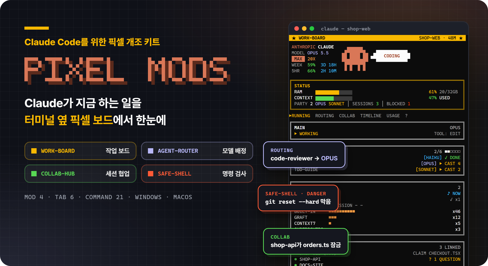
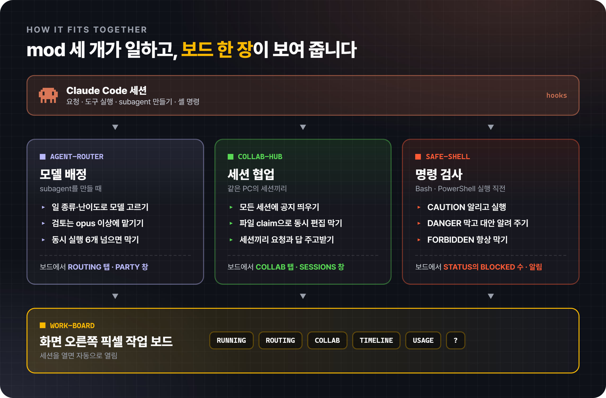
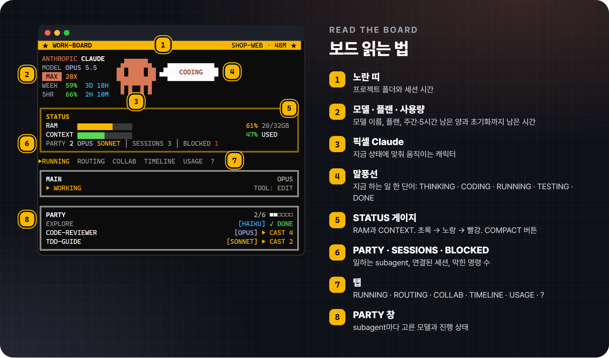
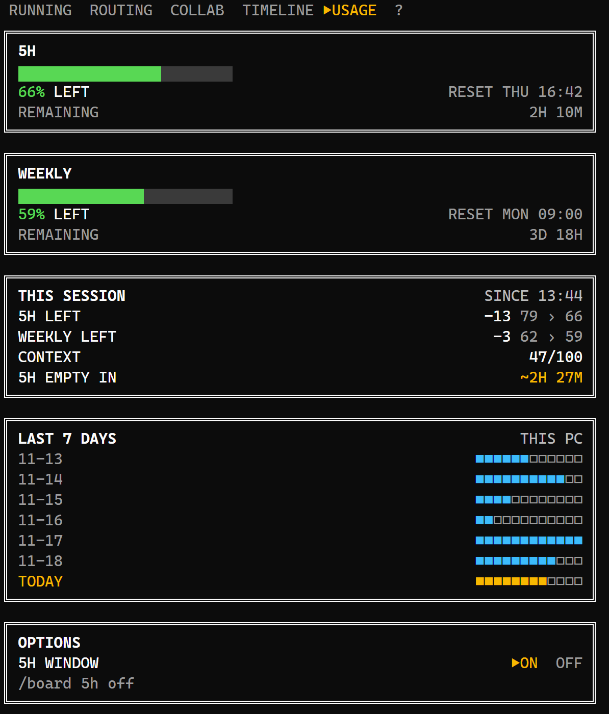
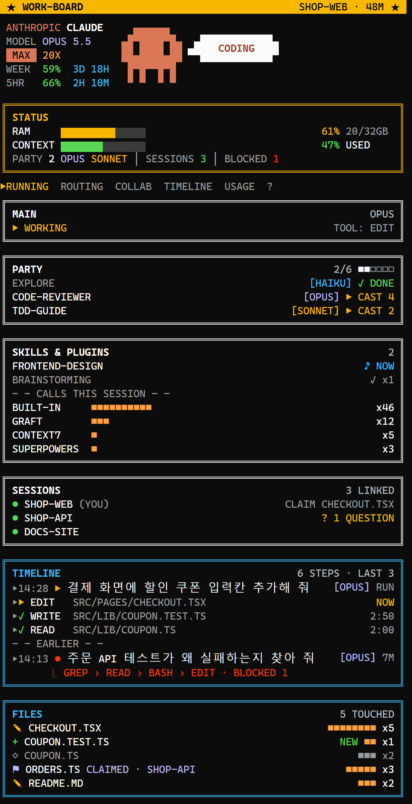
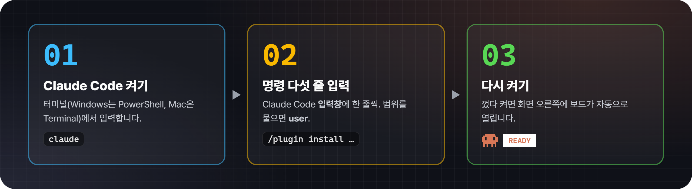
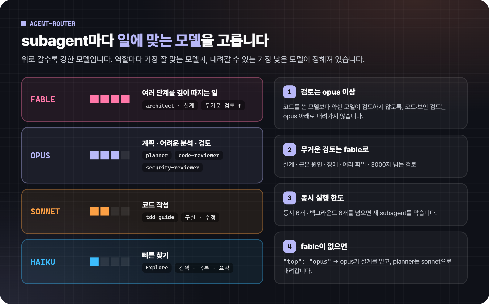
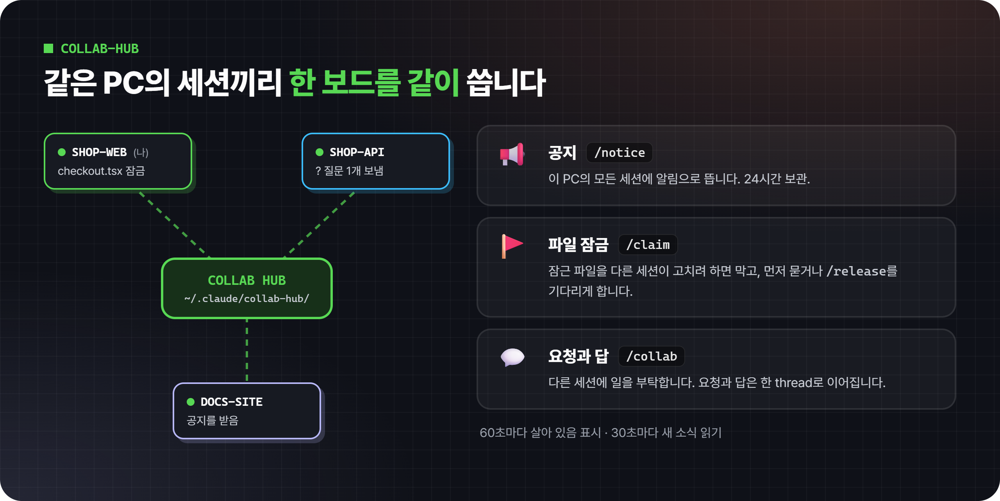
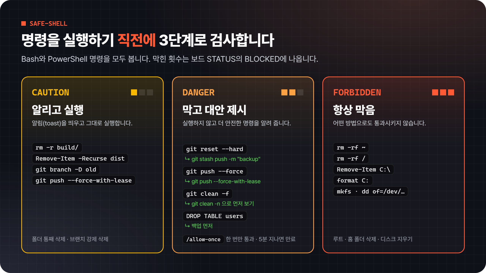

<p align="center">
  
</p>

<div align="center">


**mod 4개** | 작업 보드 · 모델 배정 · 세션 협업 · 명령 검사 | Windows · macOS | Claude Code

</div>

---

<div align="center">

<a href="#설치하기"></a>
<a href="#업데이트"></a>
<a href="#화면-보기"></a>
<a href="#mod-하나씩-보기"></a>
<a href="#명령어-목록"></a>
<a href="#지우기"></a>

</div>

---

# 📘 한눈에 보기

<p align="center"></p>

| mod | 하는 일 | 언제 움직이나 | 명령 |
|---|---|---|---|
| 🟨 **work-board** | 오른쪽 픽셀 작업 보드 | 세션을 열 때 | `/board` |
| 🟪 **agent-router** | subagent 모델 배정 · 동시 실행 제한 | subagent를 만들 때 | `/routing` |
| 🟩 **collab-hub** | 세션끼리 공지 · 파일 잠금 · 요청 | 늘 (30초마다) | `/collab` |
| 🟥 **safe-shell** | Bash · PowerShell 명령 3단계 검사 | 명령 실행 직전 | `/safe-shell` |

> work-board는 나머지 세 mod를 의존성으로 선언합니다. 네 mod 모두 따로 켜고 끌 수 있는 독립 플러그인입니다.

## 보드 읽는 법

<p align="center"></p>

### 탭 6개

| 탭 | 보여 주는 것 | mod |
|---|---|:---:|
| **RUNNING** | 메인 상태 · subagent(PARTY) · 스킬과 플러그인 · 다른 세션 · timeline · 파일 | 🟨 🟪 🟩 |
| **ROUTING** | subagent마다 고른 모델과 이유 · 동시 실행 한도 · 메인 모델 힌트를 따랐는지 | 🟪 |
| **COLLAB** | 이 PC의 세션 · claim한 파일 · 주고받은 요청(thread) · 공지 | 🟩 |
| **TIMELINE** | 요청과 도구 단계를 길게 | 🟨 |
| **USAGE** | 5시간·주간 남은 양과 초기화 시각 · 이번 세션 사용량 · 최근 7일 | 🟨 |
| **?** | 명령 안내 | 🟨 |

## 화면 보기

<table>
<tr>
<th width="33%">🟪 ROUTING</th>
<th width="33%">🟩 COLLAB</th>
<th width="33%">🟨 USAGE</th>
</tr>
<tr>
<td valign="top"></td>
<td valign="top"></td>
<td valign="top"></td>
</tr>
<tr>
<td valign="top" align="center">모델과 이유 · 한도 · 힌트</td>
<td valign="top" align="center">세션 · 잠금 · 요청 · 공지</td>
<td valign="top" align="center">남은 양 · 초기화 · 7일 기록</td>
</tr>
</table>

<details>
<summary><b>RUNNING 탭 전체 화면 보기</b></summary>
<br>
<p align="center"></p>
</details>

> 그림은 예시 데이터를 넣어 실제 보드 코드로 그린 화면입니다.

<br>

---

# 🧩 설치와 업데이트

## 설치하기

<p align="center"></p>

### 🤖 가장 쉬운 방법: 주소 붙여넣기

Claude Code 입력창에 저장소 주소를 붙여넣고 설치해 달라고 하면, Claude가 OS를 확인해 맞는 버전을 대신 설치해 줍니다.

```text
https://github.com/akaz01/pixel-mods 설치해줘
```

| 확인할 것 | 내용 |
|---|---|
| 🔁 다시 켜기 | 설치가 끝나면 Claude Code를 껐다 켜야 mod가 보임 |
| 🙋 물어보면 | 설치 범위는 **user**, 실행 승인은 허용으로 답하면 됨 |

### ⌨️ 직접 입력하기

> [!IMPORTANT]
> 명령은 PowerShell이나 터미널이 아니라 **Claude Code 입력창**에 한 줄씩 입력합니다. 설치 범위(scope)를 물으면 **user**를 고릅니다. 그래야 모든 폴더에서 켜집니다.

<table>
<tr><th width="50%">🪟 Windows</th><th width="50%">🍎 Mac</th></tr>
<tr>
<td>

```text
/plugin marketplace add akaz01/pixel-mods
/plugin install work-board@pixel-mods
/plugin install agent-router@pixel-mods
/plugin install collab-hub@pixel-mods
/plugin install safe-shell@pixel-mods
```

</td>
<td>

```text
/plugin marketplace add akaz01/pixel-mods
/plugin install work-board-macos@pixel-mods
/plugin install agent-router-macos@pixel-mods
/plugin install collab-hub-macos@pixel-mods
/plugin install safe-shell-macos@pixel-mods
```

</td>
</tr>
</table>

| 확인할 것 | 내용 |
|---|---|
| ✅ 설치 확인 | `/plugin` → Installed에 네 mod가 `@pixel-mods`로 보이면 끝 |
| ⚠️ 한 OS 버전만 | 둘 다 켜면 `/board` 같은 명령이 겹쳐 나중에 켜진 쪽이 거부됨 |
| 🖥️ 데스크톱 앱 | Code 탭에선 설치 불가. 터미널에서 user 범위로 설치하면 앱에서도 켜짐 |

## 켜고 끄기

| 하고 싶은 일 | 입력 | 결과 |
|---|---|---|
| 보드 닫기 | `/board close` | 다음 세션부터 자동으로 열리지 않음 |
| 보드 다시 열기 | `/board` | 다음 세션부터 다시 자동으로 열림 |
| mod 잠시 끄기 | `/plugin disable <mod>@pixel-mods` | 그 mod만 꺼짐 |
| mod 다시 켜기 | `/plugin enable <mod>@pixel-mods` | 다시 켜짐 |

> macOS에서는 mod 이름 뒤에 `-macos`가 붙습니다. 예: `work-board-macos@pixel-mods`

## 업데이트

| 단계 | 할 일 |
|:---:|---|
| 1 | 입력창에 `/plugin marketplace update pixel-mods` |
| 2 | `/plugin` → Installed 목록에서 mod를 골라 업데이트 |
| 3 | Claude Code를 껐다가 다시 켜기 |

## 지우기

Claude Code 입력창에 한 줄씩 입력합니다.

<table>
<tr><th width="50%">🪟 Windows</th><th width="50%">🍎 Mac</th></tr>
<tr>
<td>

```text
/plugin uninstall work-board@pixel-mods
/plugin uninstall agent-router@pixel-mods
/plugin uninstall collab-hub@pixel-mods
/plugin uninstall safe-shell@pixel-mods
/plugin marketplace remove pixel-mods
```

</td>
<td>

```text
/plugin uninstall work-board-macos@pixel-mods
/plugin uninstall agent-router-macos@pixel-mods
/plugin uninstall collab-hub-macos@pixel-mods
/plugin uninstall safe-shell-macos@pixel-mods
/plugin marketplace remove pixel-mods
```

</td>
</tr>
</table>

<br>

---

# 🕹️ mod 소개

## mod 하나씩 보기

### 🟨 work-board · 픽셀 작업 보드

세션을 열면 화면 오른쪽에 자동으로 붙습니다. 화면 구성은 위 [보드 읽는 법](#보드-읽는-법)에 있습니다.

| 항목 | 내용 |
|---|---|
| 말풍선 상태 | `THINKING` `CODING` `RUNNING` `TESTING` `WRAPPING` `DONE` `READY` `SLEEPING` |
| 게이지 색 | 🟩 여유 → 🟨 주의 → 🟥 거의 참 |
| CONTEXT 줄 | COMPACT 버튼으로 바로 압축 |
| 5시간 한도 없는 플랜 | 5HR 줄 대신 week 게이지 (Ultra 등) |
| 비우기 | `/board clear`로 timeline과 files 목록 비우기 |

### 🟪 agent-router · 모델 배정

<p align="center"></p>

**모델을 고르는 순서**

| 순서 | 기준 | 예 |
|:---:|---|---|
| 1 | **type 규칙** (`rules.json`) | architect → fable · Explore → haiku |
| 2 | **검토 담당** → code-reviewer 규칙 | typescript-reviewer · Code Reviewer |
| 3 | **작업 level** (type 규칙이 없을 때) | L3 opus · L2 sonnet · L1 haiku |
| — | fork와 workflow는 건드리지 않음 | |

> 검토 담당은 이름이 `reviewer`로 끝나거나(예: `ecc:python-reviewer`) 요청에 "리뷰 · 코드 검토 · review"가 들어 있는 subagent입니다.

**기본 `rules.json`** (`best` 가장 잘 맞는 모델 · `min` 내려갈 수 있는 가장 낮은 모델 · `up` 무거운 일에 올라갈 모델)

| 담당 | best | min | up |
|---|:---:|:---:|:---:|
| architect | fable | opus | — |
| planner | opus | sonnet | — |
| code-reviewer · security-reviewer | opus | opus | fable |
| tdd-guide | sonnet | sonnet | sonnet |
| Explore | haiku | haiku | haiku |

**계정에 따른 배분** (`rules.json`의 `top`)

| `top` | architect | planner | 코드·보안 검토 | 무거운 검토 |
|---|:---:|:---:|:---:|:---:|
| `fable` (기본) | fable | opus | opus | fable |
| `opus` (fable을 못 쓰는 계정) | opus | sonnet | opus | opus |

> 검토는 `min`이 opus라서 sonnet으로 내려가지 않습니다. `/routing rules`로 지금 배분을 볼 수 있습니다.

**메인 스레드 모델 힌트** · 모델은 바꾸지 않고 알림(toast)만 띄웁니다

| 지금 모델 | 하는 일 | 알림 |
|---|---|---|
| opus | 설계 · 아키텍처 · 근본 원인 · 장애 | fable 권함 (fable을 쓸 수 있는 계정만) |
| fable | 평범한 수정 · 구현 | opus로 내려가라고 알림 |
| opus보다 약한 모델 | 무거운 일 | 한 단계 위 모델 권함 |
| opus 이상 | 가벼운 일 | haiku 권함 |

| 그 밖의 규칙 | 내용 |
|---|---|
| 동시 실행 한도 | 동시 6개 · 백그라운드 6개를 넘으면 새 subagent를 막음 (routing을 꺼도 적용) |
| fable 지침 | 메인이 fable이 아니고 계정에 fable이 있으면 시스템 프롬프트 끝에 한 단락을 덧붙임 |

> fable 지침(`agent-router:fable`)은 깊은 판단이 필요한 조각만 `model: "fable"` 담당에게 맡기라는 내용입니다. 문장이 바뀌지 않아 프롬프트 캐시를 깨지 않습니다.

### 🟩 collab-hub · 세션 협업

<p align="center"></p>

| 기능 | 명령 | 동작 |
|---|---|---|
| 📢 공지 | `/notice <text>` | 이 PC의 모든 세션에 알림 (24시간 보관) |
| 🚩 파일 잠금 | `/claim <file>` | 다른 세션이 그 파일을 Edit/Write하지 못하게 막음 |
| 🔓 잠금 풀기 | `/release <file>\|all` | 파일 하나 또는 전부 풀기 |
| 💬 요청과 답 | `/collab <session> <task>` | `[hub]` REQUEST를 보내고, 답은 한 thread로 이어짐 |
| 🏷️ 이름 | `/collab name <name>` | 이 세션의 이름 바꾸기 |
| 📋 세션 보드 | `/collab` | 연결된 세션 보기 |

> 잠긴 파일을 고치려던 세션은 막힌 뒤, 잠근 세션에 먼저 묻거나 잠금이 풀릴 때까지 기다립니다.

| 동작 주기 | 저장 위치 |
|---|---|
| 60초마다 살아 있음 표시(heartbeat) · 30초마다 다른 세션과 공지 읽기 | `~/.claude/collab-hub/` |

### 🟥 safe-shell · 명령 검사

<p align="center"></p>

| 단계 | 동작 | 예 | 통과 |
|---|---|---|:---:|
| 🟨 **CAUTION** | 알리고 실행 | 폴더 통째 삭제 · 브랜치 강제 삭제 | — |
| 🟧 **DANGER** | 막고 대안 제시 | 변경 버리기 · 원격 기록 덮어쓰기 · DB 테이블 삭제 | `/allow-once` |
| 🟥 **FORBIDDEN** | 항상 막음 | 루트 · 홈 폴더 삭제 · 포맷 · 디스크 덮어쓰기 | ❌ |

`/allow-once`는 막힌 명령의 위험한 한 단계만 한 번 통과시키고, 5분이 지나면 만료됩니다. `/safe-shell`은 단계별 규칙과 이번 세션의 횟수(caution · danger · forbidden)를 보여 줍니다.

## Windows 버전과 macOS 버전

명령 이름과 기능은 같습니다. macOS 버전은 Mac 기본 터미널에서 깨끗하게 보이도록 아래가 다릅니다. 글꼴이나 터미널 설정은 바꾸지 않아도 됩니다.

| | 🪟 Windows | 🍎 macOS |
|---|---|---|
| 설치 이름 | `<mod>@pixel-mods` | `<mod>-macos@pixel-mods` |
| 폴더 | 저장소 루트 | `macos/` |
| 보드 캐릭터 | 블록 글자 `█▄▀` | 배경색 칸 |
| 창 테두리 | 겹선 `╔═╗` | 둥근 홑선 `╭─╮` |
| 말풍선 | 픽셀 말풍선 | 흰 칸 말풍선 · 글자 가운데 |
| 긴 줄 | — | 창 너비에서 자르고 끝에 여백 |
| RAM | Windows 메모리 정보 | Activity Monitor와 같은 기준 |
| collab-hub 경로 | Windows 경로 | `/` 경로 · `~`는 홈 폴더 |
| safe-shell 금지 | `Remove-Item C:\` · `format C:` 등 | 시스템 폴더 삭제 · `diskutil erase…` 등 |

> - Terminal.app은 블록 글자 사이에 틈이 생기고 겹선이 점선처럼 끊겨서, macOS 버전은 배경색 칸과 홑선으로 그립니다. 말풍선은 왼쪽 날개가 꼬리입니다.
> - macOS RAM은 앱 메모리 + wired + 압축이며 `vm_stat` · `sysctl`로 읽습니다.
> - macOS collab-hub는 한글 파일 이름의 NFD/NFC 차이와 대소문자 차이를 같은 파일로 봅니다.
> - macOS safe-shell은 `/Users/<이름>`, `/System`, `/Library`, `/Applications`, `/usr` 삭제와 `diskutil erase…` · `partitionDisk`를 FORBIDDEN으로 막습니다.

<br>

---

# ⌨️ 명령어

## 명령어 목록

모든 명령은 Claude Code 입력창에 입력합니다.

| mod | 명령 | 설명 |
|:---:|---|---|
| 🟨 | `/board` | 보드를 열거나 닫기 (토글) |
| 🟨 | `/board close` | 보드 닫기 |
| 🟨 | `/board help` | 명령 안내 탭(`?`) 열기 |
| 🟨 | `/board clear` · `/board-clear` | timeline과 files 목록 비우기 |
| 🟨 | `/board 5h on\|off` | 5시간 한도 줄 보이기 / 숨기기 |
| 🟨 | `/board-5h-on` · `/board-5h-off` | 위와 같음 (짧은 이름) |
| 🟪 | `/routing` | 라우팅 요약 (스위치 상태, 모델별 횟수, 최근 결정) |
| 🟪 | `/routing on\|off` | 라우팅 전체 켜기 / 끄기 |
| 🟪 | `/routing level on\|off` | 작업 level(L1-L3) 기준 라우팅 켜기 / 끄기 |
| 🟪 | `/routing hints on\|off` | 메인 스레드 모델 힌트 켜기 / 끄기 |
| 🟪 | `/routing rules` | `rules.json`을 다시 읽고 규칙 보여 주기 |
| 🟩 | `/collab` | 세션 보드 보기 |
| 🟩 | `/collab name <name>` | 이 세션 이름 바꾸기 |
| 🟩 | `/collab <session> <task>` | 다른 세션에 `[hub]` REQUEST 보내기 |
| 🟩 | `/notice <text>` | 이 PC의 모든 세션에 공지 |
| 🟩 | `/claim <file>` | 파일을 이 세션이 편집 중이라고 잠그기 |
| 🟩 | `/release <file>\|all` | 잠금 풀기 / 전부 풀기 |
| 🟥 | `/allow-once [off]` | 다음 DANGER 명령 한 번 통과 (`off`: 취소) |
| 🟥 | `/safe-shell` | 단계별 규칙과 이번 세션 횟수 보기 |

<br>

---

# 🛠 개발자용

## 폴더 구조

| 위치 | 내용 |
|---|---|
| `<mod>/` | Windows 버전 mod |
| `macos/<mod>/` | macOS 버전 mod |
| `.claude-plugin/marketplace.json` | 여덟 mod를 한 마켓플레이스로 묶음 |
| `agent-router/rules.json` | 모델 배정 규칙 |
| `docs/images/` | README 그림 |

```text
<mod>/
  .claude-plugin/plugin.json
  hooks/
  types/
  tests/
```

## 직접 해 보기

| 하고 싶은 일 | 명령 |
|---|---|
| 한 세션에서만 써 보기 | `claude --plugin-dir <mod folder>` |
| 테스트 | `claude plugin test <mod folder>` |
| 검증 | `claude plugin validate <mod folder>` |
